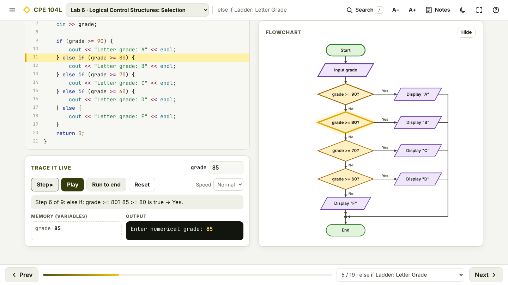

# CPE 104L · Programming Logic and Design: Lecture Slides (Labs 1–15)

Interactive lecture slides for **CPE 104L – Programming Logic and Design** (2-unit laboratory, BS Computer Engineering, College of Engineering, Bulacan State University, 2nd Semester A.Y. 2026–2027).

The site is pure **HTML, CSS, and vanilla JavaScript**: no build step, no framework, no internet needed. Open `index.html` and teach, or publish the folder unchanged on **GitHub Pages**.



## What's inside

| Page | Contents |
|---|---|
| `index.html` | **Course hub**: every lab as a card (week, ILOs, topics), part filters, a search box over all slides, and grading at a glance |
| `labs/orientation.html` | Week 1 orientation from the syllabus: course description, VMGO, COs/POs, schedule, grading, all three 5-level rubrics, policies |
| `labs/lab-01.html` … `labs/lab-15.html` | One slide deck per lab, each with ILOs and week, key concepts, C++/pseudocode code with real output, flowcharts, live tracers, quick check, seatwork, the graded Laboratory Exercise, and instructor notes |
| `labs/_template.html` | **Template and component gallery**: copy it to make a new lab |

### Labs

| Lab | Week | Topic |
|---|---|---|
| 1 | 2 | Algorithm, Pseudocode, and Flowchart |
| 2 | 3 | Basics of C++ |
| 3 | 4 | Data Types, Constants, Variables, and Strings |
| 4 | 5 | Operators and Its Hierarchy |
| 5 | 6 | Logical Control Structures: Sequential |
| 6 | 6 | Logical Control Structures: Selection |
| 7 | 7 | Logical Control Structures: Iteration Part 1 |
| 8 | 8 | Logical Control Structures: Iteration Part 2 |
| — | 9 | *Midterm Practical Exam* |
| 9 | 10 | Array |
| 10 | 11 | References and Pointers |
| 11 | 12 | Functions |
| 12 | 13 | Intro to OOP: Classes and Objects |
| 13 | 14 | Intro to OOP: Encapsulation and Inheritance |
| 14 | 15 | Intro to OOP: Polymorphism |
| 15 | 16 | Debugging Techniques |
| — | 17–18 | *Final Project · Final Practical Exam* |

The syllabus lists "Lab No. 13 & 14 – Encapsulation, Inheritance, and Polymorphism" as one item for Weeks 14–15. Here it is split into two decks.

## Features

- **Navigation:** a lab switcher in the top bar, a sidebar of slides grouped by section, a jump menu, a Prev/Next button that becomes "Next lab ▸" on the last slide, keyboard arrows, presentation clickers, and swipe on tablets.
- **Search everything:** press `/` (or Ctrl+K) on any page to search all labs and slides, or type `lab 9` to list that lab's slides.
- **Instructor Notes**, hidden by default: press `N`. They hold timing, teaching tips, common student mistakes, and questions to ask.
- **Readable in class:** light/dark mode (`T`), text size (`A−`/`A+`), full screen (`F`), and blank screen (`B`).
- **Distinct boxes** for Key Concepts, Common Pitfalls, Practice, and Notes. **C++ highlighting** with line numbers and a Copy button. **Inline SVG flowcharts and memory diagrams**, with no image files to break.
- **Live tracers:** step through a program line by line. The current code line and flowchart symbol light up, and the Memory (variables) and Output panels update as you go.
- Seatwork **timer**, step-by-step **reveals**, **Quick Check** questions, and hidden seatwork answers.
- **Print-friendly:** each slide prints on its own page, and notes print too if they are switched on.

## Run it locally

Double-click **`index.html`**. Everything works from `file://`, offline.

To serve it the way GitHub Pages will:

```bash
cd cpe104l-pld
```

```bash
python -m http.server 8000
```

Then open <http://localhost:8000> (use `python3` on some systems; VS Code's Live Server extension also works).

## Keyboard shortcuts (slide pages)

| Key | Action |
|---|---|
| `→` `PageDown` / `←` `PageUp` | Next / previous slide |
| `Home` / `End` | First / last slide |
| `]` / `[` | Next / previous lab |
| `/` or `Ctrl+K` | Search all labs |
| `N` | Instructor notes |
| `M` | Slide list |
| `T` | Light / dark |
| `F` | Full screen |
| `B` or `.` | Blank screen |
| `+` `−` `0` | Text size |
| `?` | Help |

## Folder structure

```
cpe104l-pld/
├── index.html                 ← course hub (lab cards, search, grading)
├── labs/
│   ├── orientation.html       ← Week 1 orientation (syllabus, rubrics, policies)
│   ├── lab-01.html … lab-15.html
│   └── _template.html         ← copy to create a new lab (component gallery)
├── css/styles.css             ← design tokens, light/dark themes, all components
├── js/
│   ├── script.js              ← shared engine: navigation, notes, search, tracers…
│   ├── course.js              ← the lab catalog: titles, weeks, ILOs, topics, attachments
│   ├── search-index.js        ← generated slide index for cross-lab search
│   └── labs/lab-NN.js         ← per-lab tracer scripts
├── materials/                 ← put PPT/PDF handouts here (see below)
├── tools/
│   ├── build-search-index.js  ← regenerates js/search-index.js (Node.js, no packages)
│   └── lock-activities.js     ← encrypts the graded activities (uses the private package)
├── docs/AUTHORING.md          ← how to write slides and components
└── README.md
```

## Editing and adding labs

The full guide is in **[docs/AUTHORING.md](docs/AUTHORING.md)**. In short:

1. **Edit a slide:** open `labs/lab-NN.html`. Each `<section class="slide">` is one slide, and its `<aside class="notes">` holds the instructor notes.
2. **Add a lab:** copy `labs/_template.html` to `labs/lab-16.html`, set `data-page="lab-16"`, and add an entry to `js/course.js`. The home page, lab switcher, and search pick it up automatically.
3. **Refresh search** after editing slides (optional; the current lab is always searchable):

   ```bash
   node tools/build-search-index.js
   ```

4. **Course details:** the semester and course info are at the top of `js/course.js`. No instructor name is shown, so several instructors can share the site.

## Attaching PPT / PDF files

1. Copy the file into `materials/` (e.g. `materials/LAB_02_Basics_of_C.pptx`).
2. In `js/course.js`, add it to that lab's `materials` list:

   ```js
   materials: [{ label: 'Lab 2 slides (PPTX)', href: 'materials/LAB_02_Basics_of_C.pptx' }]
   ```

3. The file appears as a download link on that lab's card on the home page.

> Everything in a public GitHub repository is public on GitHub Pages, including file contents and the page source. Keep answer keys and solution files out of `materials/`.

## Locked laboratory activities

Each lab's **graded activity** (the Laboratory Exercise slides) is **locked**. In this repository those slides are stored encrypted (AES-256-GCM, key derived from a per-lab passphrase with PBKDF2). Visitors see a "This lab activity is locked" card instead. The activity appears only after someone types that lab's passphrase, and without it the content cannot be read, even in the page source. Lectures, examples, seatwork, and quick checks stay open to everyone.

- **Instructors:** unlock on the classroom PC by typing the passphrase on the locked slide. It stays unlocked on that browser until you press **Lock again**.
- **Release to students:** announce or post the passphrase (e.g. in MS Teams). Each student types it once.
- **Passphrases, readable activity files, and answer keys** live in the separate **private instructor package** (`cpe104l-instructor-private`). Never commit that folder here.
- **Edit an activity, or change a passphrase to re-lock it for everyone:** edit the private files, then run:

  ```bash
  node tools/lock-activities.js ../cpe104l-instructor-private
  ```

  ```bash
  node tools/build-search-index.js
  ```

Limits: anyone who has a passphrase can share it, and all sections share one passphrase per lab. The lock controls *when* students can first read an activity; it is not an exam-security system.

## Publish on GitHub (make it live)

### Option A: upload in the browser (no git needed)

1. Sign in to GitHub and create a **new public repository** (e.g. `cpe104l-pld`). Leave "Add a README" unchecked.
2. On the empty repository page, click **uploading an existing file**.
3. Unzip `cpe104l-pld.zip`, open the `cpe104l-pld` folder, select **everything inside it** (`index.html`, `labs`, `css`, `js`, `docs`, `tools`, `materials`, `README.md`), and drag it onto the upload page. Wait until every file is listed, then click **Commit changes**.
4. Go to **Settings → Pages**. Under *Build and deployment*, set **Source** to *Deploy from a branch*, choose **`main`** and **`/ (root)`**, and click **Save**.
5. After 1–2 minutes the site is live at `https://YOUR-USERNAME.github.io/cpe104l-pld/`. Share that link with instructors and students.

To update later, upload the changed files the same way (GitHub replaces files with the same name).

### Option B: with git

1. Create an **empty** public repository on GitHub, e.g. `cpe104l-pld`.
2. In the project folder:

```bash
git init
```

```bash
git add .
```

```bash
git commit -m "CPE 104L lecture slides, Labs 1-15"
```

```bash
git branch -M main
```

```bash
git remote add origin https://github.com/YOUR-USERNAME/cpe104l-pld.git
```

```bash
git push -u origin main
```

3. On GitHub, go to **Settings → Pages**, set **Source** to *Deploy from a branch*, and choose `main` and `/ (root)`. The site appears at `https://YOUR-USERNAME.github.io/cpe104l-pld/`.

GitHub Pages is free for public repositories. The site needs no server or build step.

To update the site later:

```bash
git add . && git commit -m "Update slides" && git push
```

## Content sources

- *CPE 104L Course Syllabus* (2nd Sem, A.Y. 2026–2027): ILOs, weeks, activities, COs/POs, rubrics, grading, and policies.
- Instructor slide decks: *LAB 1 – Algorithm, Pseudocode, and Flowchart*, *LAB 2 – Basics of C++*, *LAB 3 – Data Types, Constants and Variables, and Strings*.
- Labs 4–15 were written to the syllabus learning episodes and the course references (Farrell; Gaddis; Malik; Deitel). Every complete C++ example was compiled with `g++ -std=c++17 -Wall -Wextra`, and the outputs shown are real program output.

## Browser support

Current Chrome, Edge, Firefox, and Safari (desktop and mobile). Without JavaScript, slides display as one long page.
